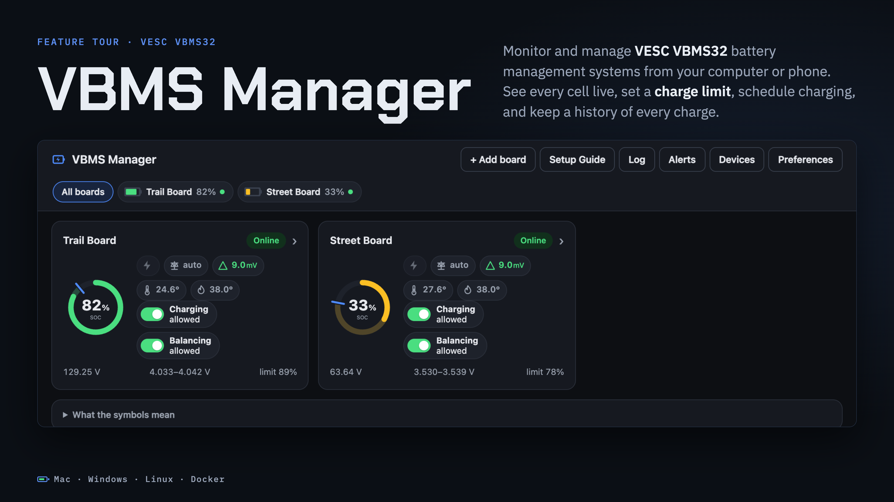

# VBMS Manager

A local tool for VESC **VBMS32** battery management systems (as used in VESC-converted Onewheels and other boards). It connects to the BMS over WiFi (or, in the Mac app, over Bluetooth when there's no network) so you can:

- see state of charge, every cell (on a fixed 3.0–4.2 V scale), imbalance, balancing and temperatures as visuals, for several boards
- set a **60–100 % charge limit** in 1 % steps; Charge Start stays **0.100 V** below Charge End (you can unlink it on the graph, 0.050–0.200 V)
- **drag thresholds on the graphs** (charge end/start, balance minimum, temperature limits, balance start/end) or click a label to type an exact value
- **schedule** charging and balancing: drag blocks (*Charge to N %*, *No charging*, *No balancing*, …) or single events (*Set limit 90 % at 5:00 PM*) onto a week view, repeating weekly or one time
- **timers** from the Overview, Charging and Balancing screens: *start charging to 90 % in 4 h*, *stop balancing at 11:00 PM*
- **Charging / Balancing switches** on the Overview and Charging cards that show whether each is allowed, and why
- edit the BMS's **balancing, charging, sleep/SOC, protection and WiFi/Bluetooth/CAN** settings, with warnings on the risky ones
- see the charge logic in the script that's actually running on the BMS
- use it from your phone on the same network (view-only until you pair the phone)
- record history (power in/out, amps, volts, every cell and temperature), graph it, log every charge, get alerts, and export VESC Tool–compatible config backups



**[See the feature tour →](feature-tour/README.md)**

It runs on your computer and shows its UI in your browser at `http://127.0.0.1:8642`. There are downloads for Mac, Windows and Linux (Python included, nothing else to install) and a Docker image, or run it from source with Python 3.8+. A **Setup guide** in the app walks through getting a VBMS onto WiFi.

> [!CAUTION]
> **This software was written by an AI (Claude, made by Anthropic). No human has reviewed it.** Trusting unverified, AI-generated software to manage a lithium battery that's connected to a charger in your home is a bad idea. You use it **entirely at your own risk**, with no warranty. It may damage your BMS, battery, charger or board, or cause a **lithium battery fire**. It hasn't been tested in every scenario or on every hardware, firmware and script version (only two VBMS32 boards on FW 7.00), and it may malfunction.
>
> The app shows this warning for every new board. Until you accept it for that board, the app only reads from it.

> [!WARNING]
> **It keeps your BMS awake, which slowly drains the battery.** While VBMS Manager is connected to a board, its BMS never goes to sleep and keeps powering itself from the pack, so it will drain your battery over the course of weeks. In practice that's a few percent per day. If the board is left plugged in, the charger will also kick on for about 30 seconds roughly twice a day to top the pack back up. Before you store a board or leave it for days, quit VBMS Manager or use **Board → Free for VESC Tool** so the BMS can sleep.

> **Lithium safety.** Nothing is written to a BMS until you confirm that exact change. Schedules and timers are the exception: once you approve one, its writes run automatically without asking you again. You can also turn routine confirmations off (see [Skipping confirmations](#skipping-confirmations)). Every write is backed up, read back and logged. Read [How writes are kept safe](#how-writes-are-kept-safe) before you use it, and keep checking your boards with VESC Tool as usual.

---

## Quick start

1. **Set up the BMS once in VESC Tool** (over USB or BLE), on the BMS's custom config page:
   - **WiFi Mode** = *Station*, and enter your network's SSID and key
   - **TCP Local** = enabled (VESC's protocol on port 65102)
   - Optional: give each board its own **BLE name** so they're easy to tell apart
   - Write the config. Once the BMS is awake (for example on the charger), it joins your WiFi.
2. **Run the tool**
   - **Mac:** open the DMG and drag **VBMS Manager** into Applications, then open it. The beta isn't notarized by Apple, so the first time macOS blocks it: click *Done*, then go to **System Settings → Privacy & Security → Open Anyway**. You only do this once. It lives in the menu bar (battery icon), with no Dock icon, and starts when you log in so schedules keep running. The menu has *Open VBMS Manager*, *Use from Phones on This Network*, *Open at Login*, *Show Data Folder*, *Show Log* and *Quit*. Its log is in `~/Library/Logs/VBMS Manager/`.
   - **Windows:** unzip the Windows download and double-click **VBMS Manager** (`VBMS Manager.cmd`) in the folder. The beta isn't signed, so if Windows says it protected your PC, click *More info → Run anyway*. A console window stays open while it runs; close it to stop. Its *Read Me First.txt* covers starting it at login.
   - **Linux** (PC or Raspberry Pi): unpack the download for your CPU and run `./vbms-manager`, or `./install.sh` to add it to your apps. `./install.sh --service --lan` runs it in the background at every boot, for an always-on computer. See [Running on an always-on computer](#running-on-an-always-on-computer).
   - **Docker:** see [Docker](#docker).
   - **From source** (any computer with Python 3.8+, nothing to build):
     ```bash
     python3 vbms_manager.py
     ```
     On Windows, use `py vbms_manager.py` if `python3` isn't found.

   The Mac, Windows and Linux downloads include Python, so there's nothing else to install.

   Your browser opens and VBMS Manager searches your network for boards. Boards it finds show up at the top with an **Add** button. If one doesn't show up, type its IP and click **Add board**. You can also pass IPs: `python3 vbms_manager.py --add 192.168.1.50 --add 192.168.1.51`.
3. **Board setup** opens by itself the first time the tool sees a new board: the **safety warning** (writes stay locked until you accept it), name, **cell type**, review and accept the **SOC curve**, a check of the **running Lisp script** (see below), and the optional **charger latch** add-on. It only appears once; reopen it with **Board → Edit board setup**. It saves to VBMS Manager only and writes nothing to the BMS, unless you choose to install the add-on.
4. Tap the **Charge limit** button (Overview or Charging tab), pick a percentage, check the values in the dialog, tick the box, and click **Write to BMS**.

Each board has tabs: **Overview**, **Cells**, **Temps**, **Charging** (limit, pause/allow, charging settings), **Schedule** (what's happening now, timers, the week, schedule items), **Balancing**, **History**, **Settings** (sleep & SOC, protection, WiFi/Bluetooth/CAN) and **Board** (setup, script check, add-ons, logging, export, connection, events, full config). On narrow screens (phones, tablets in portrait) the tabs show icons, with the open tab's name, and the header buttons (Setup guide, Log, Alerts, Devices, Preferences, API docs) move into the ☰ menu. A tab with unsaved edits has a dot, and the page asks before you leave with unsaved edits. After a successful write, a short message confirms what the board read back, with **View in log** for the details and the backup's path.

**Only one app can talk to a board at a time.** While VBMS Manager is connected, VESC Tool can't connect to that board over WiFi (and the other way round). Click **Board → Free for VESC Tool**, or quit VBMS Manager, when you want VESC Tool back. A board that is "Busy" usually has VESC Tool connected to it.

**No network? Use Bluetooth (Mac app only).** In the Add board dialog, **Search Bluetooth** finds nearby boards and identifies each one by its MAC, so boards that share a Bluetooth name (they all start as *VESC BMS*) are told apart. Add one to use it over Bluetooth only. For a board you already use over WiFi, **Board → Connect over Bluetooth** switches it, and **Back to WiFi** switches it back; it never switches by itself. Before using a Bluetooth link, VBMS Manager checks the MAC matches the board you picked. Everything works the same over Bluetooth, including writes, schedules and timers. The Mac must be within Bluetooth range, macOS asks once for Bluetooth permission, and while VBMS Manager holds a board's Bluetooth link the VESC Tool phone app can't connect to it over Bluetooth (WiFi still works). Bluetooth needs **BLE Mode** on in the board's config (it is by default). The Windows, Linux and Docker versions and running from source have no Bluetooth: Python's standard library can't do it, so the Mac app relays it.

---

## How the charge limit works

The VBMS32 charge logic lives in its LispBM script. In the stock `vbms32` package (and the Onewheel variants this was tested on):

- While charging, it **stops** when the highest cell reaches **Charge End** (`vc_charge_end`). That reading is taken while charge current is flowing.
- After stopping, it only **restarts** once the highest cell drops below **Charge Start** (`vc_charge_start`). The gap (0.100 V by default) is the hysteresis that stops the charger from clicking on and off.
- **Caveat:** when the BMS wakes from sleep with a charger connected, it starts charging if the highest cell is below **Charge End**, not Start. Boards that sleep and wake on the charger can top up without the hysteresis. Scripts with a "sticky charger latch" (they keep the BMS awake on the charger) avoid this.

### Charger latch add-on (optional)

There's a bug, probably in the firmware: at the end of a charge the BMS goes to sleep, wakes straight back up, ignores **Charge Start** and charges until **Charge End**, then stops and sleeps again. So it cycles on and off rapidly while the charger is connected. It doesn't happen while the BMS stays awake. The charger latch is the stock `vbms32` script (comments removed) plus a few lines that check for a charger on every pass of the main loop (`bms-get-vchg` above 25 V). While one is connected, they keep the BMS awake until a few seconds after it's unplugged. It's a workaround, not a fix for the firmware, and the BMS doesn't sleep while a charger is connected.

The latch script is by **@fluffhead**. It's the same sticky charge latch found in **Flowstate VESC**. If you'd like, you can get the [Flowstate VESC iOS app on the App Store](https://apps.apple.com/us/app/flowstate-vesc/id6784881030).

Install it from board setup (**Add-ons** step) or **Board → Add-ons**. It's offered only when the board runs exactly the stock script the add-on was made from (compared with comments and spacing ignored), and only with the charger unplugged, because the script is stopped while it's replaced. You type the board's name to confirm, even with confirmations off. The tool saves a copy of the current script to `~/.vbms_manager/backups/`, then erases and writes the script the way VESC Tool's package install does. The new script must **read back exactly** before it's restarted. If any step fails, the previous script is written back and restarted. The BMS config isn't touched. The upload follows VESC Tool's own code (`codeloader.cpp`), but so far it has only been tested against the simulated board in `tests/mock_bms.py`.

**To undo it, re-install the BMS package from VESC Tool** (VESC Packages page). VBMS Manager can't remove it.

The slider turns a percentage into a Charge End voltage using the cell type's SOC curve:

| Setting | Charge End | Charge Start |
|---|---|---|
| 100 % | 4.210 V | 4.110 V |
| 60–99 % | from the SOC curve | End − 0.100 V |

On the **Cells** chart (and the range gauge on the Overview) you can drag the Charge End or Start line. They move together, 0.100 V apart. The 🔒 between them unlinks them so you can set any gap from 0.050 to 0.200 V; a smaller gap restarts charging sooner after it stops. Setting a limit by percentage puts the gap back to 0.100 V. Nothing is written until you click **Write**.

Because the BMS checks Charge End under charge current, the resting voltage, and so the real state of charge, ends up a little below the target. That's the safe direction.

**About the SOC curves.** Each cell type has its own resting-voltage curve (0–100 % in 5 % steps), measured on new cells and digitized from the source below. Where the maker publishes a low-rate (0.2C) discharge chart, that's the source. Where it doesn't (Sony/Murata only chart 3 A and up for the VTC6, Reliance's RS50 spec has tables but no curve), the curve comes from an independent lab test at an even lighter load. Every curve's full source, test conditions and capacity are in [cells/profiles.json](cells/profiles.json) and on the board-setup curve page; [tools/cell_curves](tools/cell_curves/README.md) has the method.

| Pack / cell | Curve from | 60 % | 80 % | 90 % |
|---|---|---|---|---|
| Onewheel Pint stock pack (Murata VTC5D) | [manufacturer datasheet, 0.2C](https://www.murata.com/-/media/webrenewal/products/batteries/cylindrical/datasheet/us18650vtc5d-product-datasheet.ashx) | 3.76 V | 3.94 V | 4.05 V |
| Onewheel Pint X / XR stock pack (Sony/Murata VTC6) | [lygte-info.dk, 0.2 A test](https://lygte-info.dk/review/batteries2012/Sony) | 3.81 V | 4.02 V | 4.07 V |
| Onewheel GT original pack (Samsung 40T or Murata VTC6A) | average of 40T and VTC6A | 3.81 V | 4.00 V | 4.07 V |
| Onewheel GT later pack (Molicel P42A) | [lygte-info.dk, 0.2 A test](https://lygte-info.dk/review/batteries2012/Molicel) | 3.81 V | 4.01 V | 4.06 V |
| Onewheel GT-S stock pack (Molicel P45B) | [manufacturer datasheet, 0.2C](https://www.batterydesign.net/genuine-p45b-tests/) | 3.79 V | 3.98 V | 4.06 V |
| Reliance RS50 | [About:Energy lab, C/30 test](https://www.aboutenergy.io/post/reliance-rs50-battery-performance-analysis) | 3.82 V | 4.03 V | 4.08 V |
| Molicel P50B | [manufacturer datasheet, 0.2C](https://www.fsaeonline.com/content/Molicel-TDS--INR-21700-P50B-80122.pdf) | 3.78 V | 3.97 V | 4.05 V |
| Samsung 50S | [manufacturer datasheet, 0.2C](https://cdn03.plentymarkets.com/i9a0e0hd8l6w/frontend/Datenblaeter/Samsung/INR21700-50S/INR21700-50S_Introduction_of_INR21700-50S_2022_v1_20220301_.pdf) | 3.79 V | 3.99 V | 4.05 V |
| Molicel P45B | [manufacturer datasheet, 0.2C](https://www.batterydesign.net/genuine-p45b-tests/) | 3.79 V | 3.98 V | 4.06 V |
| Molicel P42A | [lygte-info.dk, 0.2 A test](https://lygte-info.dk/review/batteries2012/Molicel) | 3.81 V | 4.01 V | 4.06 V |
| Samsung 40T | [lygte-info.dk, 0.2 A test](https://lygte-info.dk/review/batteries2012/Samsung) | 3.80 V | 4.00 V | 4.06 V |
| Murata VTC6A | [lygte-info.dk, 0.2 A test](https://lygte-info.dk/review/batteries2012/Sony) | 3.81 V | 4.00 V | 4.07 V |
| Molicel M35A | [manufacturer datasheet, 0.2C](https://www.molicel.com/wp-content/uploads/INR18650M35A-V2-80096.pdf) | 3.77 V | 3.96 V | 4.02 V |
| Molicel P30B | [manufacturer datasheet, 0.2C](https://fsaeonline.com/content/INR-18650-P30B-80111.pdf) | 3.79 V | 3.98 V | 4.07 V |
| Sony/Murata VTC6 | [lygte-info.dk, 0.2 A test](https://lygte-info.dk/review/batteries2012/Sony) | 3.81 V | 4.02 V | 4.07 V |
| Samsung 30Q | [lygte-info.dk, 0.2 A test](https://lygte-info.dk/review/batteries2012/Samsung) | 3.81 V | 4.01 V | 4.06 V |
| LG HG2 | [lygte-info.dk, 0.2 A test](https://lygte-info.dk/review/batteries2012/LG) | 3.78 V | 3.99 V | 4.06 V |
| Molicel P28A | [lygte-info.dk, 0.2 A test](https://lygte-info.dk/review/batteries2012/Molicel) | 3.80 V | 4.00 V | 4.06 V |
| Murata VTC5D | [manufacturer datasheet, 0.2C](https://www.murata.com/-/media/webrenewal/products/batteries/cylindrical/datasheet/us18650vtc5d-product-datasheet.ashx) | 3.76 V | 3.94 V | 4.05 V |
| Samsung 25R | [lygte-info.dk, 0.2 A test](https://lygte-info.dk/review/batteries2012/Samsung) | 3.77 V | 3.97 V | 4.06 V |
| Other NMC/NCA Li-ion cell | median of the curves above (typical, not measured) | 3.79 V | 3.99 V | 4.06 V |

- 0 % is 2.8 V under that light load and the curve's 100 % is 4.20 V, the rated charge voltage. The charge limit's 100 % is still the profile's max end (4.21 V).
- *Stock Onewheel packs* use the cells Future Motion is reported to have fitted. If you can read the print on your cells, pick the cell. The original GT pack shipped with either 40T or VTC6A, so its curve is their average (they're within 0.02 V from 60 % up).
- **Charging reads high.** The BMS compares Charge End with the cell voltage while the charger is still pushing current, which sits roughly 0.03–0.05 V above resting at typical charge rates. So a pack stopped at "80 %" settles a few percent lower. The percentages are a consistent dial, not a fuel gauge.
- Cells vary within a model and the curve shifts as they age. You can type your own voltages per board (*Save as custom curve*).
- **LiFePO4 packs** (Onewheel V1/Plus, A123 26650) aren't supported: their curve is so flat that a voltage limit can't pick a percentage.
- The safety limits below apply whatever the curve says.

## Charge schedules

The **Schedule** tab starts with what's happening right now (each channel, the next change, pending timers), then the week view. Drag a block from the palette onto a day and time, then drag it to move it or drag its edges to resize it (5-minute steps). Click it to edit the details: times are picked from 12-hour dropdowns in 5-minute steps. On a phone the week is a list by day instead: tap a palette block to add one, tap an entry to edit it. Edits stay a draft (*Edited, not saved*) until you click **Save schedule…** and approve it.

- **Blocks** run from a start to an end time: *Charge to N %*, *No charging*, *Allow charging*, *No balancing*, *Allow balancing*. A block that ends before it starts runs past midnight.
- **Single events** have no end time: *Set limit 90 % at 5:00 PM*, *Stop/Start charging*, *Stop/Start balancing*. An event holds until the next change.
- A *Charge to N %* block can either go back to the limit from before when it ends (the default), or keep its limit.
- Items repeat weekly or run once on a date. A new or edited item only counts from when you save it, so it doesn't act on a slot earlier this week.

The limit, charging and balancing are separate: a *No charging* block and a *Charge to 80 %* block can overlap. On each, **the latest change wins**. When a block ends, another block that's still running takes over (one-time items first, then the higher one in the list). If no block is running, it goes back to what the board had before.

- **Limits** write Charge Start/End. A limit you set by hand during a block is kept when the block ends.
- **No charging** uses the live *Pause charging* command, never a config write. The BMS forgets it when it restarts or wakes, so the tool re-sends it after every reconnect and every 30 s. Right after a wake, a few seconds of charging can happen before the tool reconnects.
- **No balancing** writes *Balance Max Current = 0 A* (a config write, so it survives restarts). *Allow balancing* writes back the value the board had before (or 1.0 A if it was already 0).
- Saving shows the exact writes for each item. You approve them once, and from then on the scheduled writes go through the same checks, backup, read-back and change log as a manual write. Any edit needs a new approval. Changing the board's cell type or curve turns the schedule off until you review it.

**Timers** (*Later…* on the Overview, Charging and Balancing screens, or *Add a timer…* on the Schedule tab) are one-off changes: *start charging and set 90 % in 4 hours*, *stop balancing at 11:00 PM*. A timer beats the schedule when it fires, and the schedule takes over again at its next change. Pending timers are listed with a ✕ to cancel them and appear on the week view. Changing the cell type cancels pending limit timers.

The **Charging** and **Balancing** switches show whether each is allowed right now and why (you, a schedule block, a timer). Tapping one always sends the opposite: *Pause/Allow charging* (live), or *Balance Max Current* 0 A / back (a config write). The schedule leaves your change alone until its next change on that channel.

**Schedules and timers only run while VBMS Manager is running.**

---

## How writes are kept safe

Nothing is written to a BMS until you tick the box and click **Write to BMS** in the confirmation dialog (unless you've turned routine confirmations off, see below). Before that dialog even appears:

1. **Layout from the board itself.** The tool reads the BMS's own config description (XML) and decodes the config with it, so it matches the firmware on *that* board. It then re-encodes the decoded config and requires the result to be **byte-for-byte identical** to what the board sent. If not, writes stay disabled for that board.
2. **Patch, don't rebuild.** The new config is the exact bytes read from the board with **only the changed settings' bytes replaced**. The tool checks that no other byte changed and that every other setting decodes to the same value. (Text settings like the WiFi name change length, so for those the config is re-encoded; step 1 proved that re-encoding reproduces the board's bytes exactly, and every other setting must still decode identically.)
3. **Hard limits**, checked separately from the curve. Anything outside them is refused rather than adjusted:
   - start is 0.050–0.200 V below end (0.100 V unless you unlinked it on the graph)
   - end ≤ the cell profile's max (4.21 V) and never above 4.25 V
   - end ≥ 3.60 V
   - start > *Charge Minimum Voltage* and start ≥ *Balance Minimum Voltage*
   - other settings: only a whitelist (`config_fields.py`) is editable; each has the tool's own bounds on top of the firmware's, plus cross-checks (Balance End < Balance Start, Charge Temp Min < Max, a valid WiFi key length, …). Cell counts and sensor counts stay read-only, and Charge Start/End only change through the charge limit.
   - risky settings are flagged as you type. *Danger* changes (Block Sleep on, short-circuit or temperature protection off, charging below 0 °C, WiFi/TCP/Bluetooth/CAN changes that can cut the board off) also need you to type the board's name.
4. **Script check.** The tool reads the Lisp script running on the BMS and checks that `vc_charge_start` / `vc_charge_end` are used only in the known pattern above. An unrecognized script keeps writes **locked** until you read the charge code (shown in the UI) and acknowledge it. That acknowledgement is tied to the script's SHA-256, so a changed script needs a new review.
5. Writes, live controls and schedules are blocked until you've accepted the safety warning for that board. If the warning changes in substance, every board asks again.
6. Writes are blocked while a charge over-current fault (`FLT_CHG_OC`) is latched.

When you confirm:

7. The tool re-reads the board and checks it's the **same board** (MAC address) and that the config **hasn't changed** since the dialog opened. Confirmations expire after 2 minutes and work only once.
8. It saves a **full backup** of the current config (`.xml` for VESC Tool and the raw `.bin`) to `~/.vbms_manager/backups/`.
9. It writes, waits for the BMS to acknowledge, **reads the config back and requires it to match exactly**, and logs the result to `~/.vbms_manager/changes.log` (also under **Change log** in the UI).

The tool never sends any other config-writing command. The only other flash write is the optional charger latch add-on, which replaces the Lisp script (see above). The only other commands it can send are the *live* controls (Pause/Allow charging, Force balance on/off). Those apply in RAM only, ask for confirmation (or are part of an approved schedule or timer), and reset when the BMS restarts. Turning balancing off or on is a normal config write of *Balance Max Current*.

### Skipping confirmations

Once you trust the tool, **Preferences → Ask before every write** can be turned off. It needs this computer (not a paired phone), a warning you read, a ticked box and the phrase `skip confirmations`. Any paired device can turn confirmations back on. While they're off, a **Confirmations off** chip shows at the top.

- Charge limits, settings, graph edits, the Charging/Balancing switches, schedules and timers then go through **with one tap**. A slip of the finger can leave a pack charging, or not charging, when you didn't mean it to.
- **Still asked:** ⛔ danger changes (you type the board's name) and restoring a backup.
- **Still enforced:** every hard limit, check, backup, read-back and log entry. Writes made without a confirmation are marked in the change log.

### Restoring a backup

On the Board tab, **Backups** lists the automatic pre-write backups. **Restore…** shows exactly what would change and goes through the same confirm dialog, backup, before-check and read-back as any other write (you type the board name to confirm). It refuses a backup from another board, from a different firmware/config layout, or one that would change settings VBMS Manager doesn't edit, and it re-checks charge values against today's limits.

For those cases, or to restore by hand: open the board in VESC Tool, go to the BMS config page, use **Load XML** with the `_before.xml` file from `~/.vbms_manager/backups/<board>/`, and write the config. Backups include your WiFi key so a restore doesn't knock the board off your network. Keep that folder private.

---

## Other features

- **Alerts** (top right): cell imbalance, temperature, and max cell above Charge End, plus optional notifications while the page is open for alerts, a charge finishing, a charge stopping early (unplugged, paused, fault, temperature) and a board going offline while charging. Alerts are saved in VBMS Manager, so every paired device shares them, and raised/cleared alerts go in the event log. The imbalance setting also decides when a cell is drawn as an outlier (amber); cells above Charge End + the margin, above 4.2 V or below Cell Voltage Empty are red. Everything else is one colour.
- **Recording** (Log → Recording): history for every board, set by interval (1 s–5 min, default 10 s), detail (*Summary*: pack V/A/W, SOC, lowest/highest cell, spread, hottest temp, charger; *Detailed*: + every cell, every temp sensor, balancing, Ah/Wh counters; *Everything*: + raw status and charge settings) and how long to keep it (7 days–forever, default 90 days). Values are averaged over the interval; extremes are kept. Closed days are gzipped. **Download CSV** of any range is on the Board tab.
- **History tab**: *Graphs* (power, current, voltage, SOC, cells, spread, temps, charger; 15 min to all; drag to zoom, hover to read; charges shaded), *Charges* (every session: duration, SOC, Ah/Wh, peak/average power, max temp, why it stopped), *Daily* (energy in/out per day) and *Health* (cycles, capacity estimate, weakest cell, cell drift heatmap, idle self-discharge per cell). The Cells and Temps tabs get the same range buttons, and the Charging tab shows the current charge with an ETA, or the last charge.
- **Board events** also include balancing on/off, charger plugged/unplugged, and the board going busy/offline.
- **Board events** (connect, charge start/stop with the cell voltages at that moment, faults, writes, schedule actions): `~/.vbms_manager/events.log`
- **Export config XML** from the Board tab. WiFi keys and the BLE PIN are removed unless you choose *Export with WiFi keys*.
- Full read-only view of every BMS setting.

### About the analysis

Charge sessions are measured from every 1 s reading whatever the recording interval; gaps longer than 5 s aren't integrated and are flagged. Capacity is estimated as Ah charged ÷ SOC change between a rested voltage before and after a charge, mapped through the board's SOC curve, so it's only as good as that curve and only works inside its range (the bundled curves are for new cells, so treat it as an estimate). Drift and self-discharge need *Detailed* or *Everything*. Self-discharge is measured across idle stretches and sleep gaps of 6 h or more when the BMS's lifetime counters show nothing went in or out. An awake BMS draws power itself, so the pack-level figure includes that; the useful signal is a cell that drops faster than the others.

## Storage mode and safety

**Storage mode** (Board tab, or *All into storage* on the All boards screen) is for leaving a board for weeks:
- It saves the board's Charge Start/End, Balance Min and Balance Max Current.
- It then writes the storage settings in one checked write. The defaults are Charge End **3.75 V/cell**, Start 0.100 V below that, Balance Min **3.40 V** with balancing allowed. You can change them per board.
- Schedules and timers wait while it's on.
- By default, once there's no charger, the tool disconnects so the BMS can sleep, and checks in every few hours.
- Turning it off writes the saved values back. If the board is asleep then, it's done as soon as the board reconnects.
- The BMS can't discharge a pack, so a pack above storage voltage stays there until you ride it down.

**Safety** (Preferences → Safety):
- **Low-SOC disconnect.** A board whose SOC stays under 20 % for 2 hours without a charger is disconnected, so the tool doesn't keep its BMS awake and drain it further. It reconnects briefly every 6 hours. It stays connected once the charger is plugged in, or press **Reconnect** to end the rest straight away.
- **Notices.** The dashboard, the board's banner and desktop notifications tell you when:
  - the pack has been below nominal (3.60 V/cell) for 3 days ("connect the charger");
  - a cell is under 3.20 V;
  - a pack has sat above 90 % for 7 days (suggests storage mode).
- Notices keep working while a board is asleep, using its last reading. Every threshold can be changed.

## Where things are stored

Everything is under `~/.vbms_manager/` (set `VBMS_MANAGER_HOME` to move it): `boards.json` (nicknames, cell types, accepted curves, acknowledged scripts, schedules, paired devices as hashed tokens), `history/<board>/` (recordings, one file per day, plus a cached analysis digest), `backups/` (readable only by your user account: they include the WiFi key), `changes.log`, `events.log`, `charges.log` (each rolls over to `.1` … `.5` at 5 MB). `boards.json.bak` is a known-good copy of `boards.json`, refreshed at start and hourly; if `boards.json` is ever unreadable, it's kept as `boards.json.corrupt-<time>`, the copy is used instead, and the page says so. Nothing is sent anywhere except to your boards.

## Network notes

- By default the UI is served on `127.0.0.1` only. To use it from your phone, start it once with `python3 vbms_manager.py --lan` (remembered; `--local-only` turns it off). It prints the addresses to open and a **pairing code**.
- Other devices start **view-only**. Entering the pairing code (**Devices**, or the *Pair* button) lets that device make changes; it stays paired until you remove it under **Devices** on the computer running the tool. The code changes on every start and after 10 wrong guesses, wrong guesses are rate-limited, and pairing only works from your own networks.
- Exports (which can contain WiFi keys) need a paired device.
- Clients from outside your networks (through a forwarded port) get only the key-authenticated API, never the web page or pairing. Preferences → Internet can let them watch the web page, view-only; they can never pair. Requests that came through a proxy are judged by the address the proxy reports, and are never treated as this computer.
- **Docker port mapping and some routers hide where a client really is.** With `ports:` instead of host networking, or a router that rewrites the source address of forwarded connections, internet clients arrive with an address from your own network and would be treated like a device on your WiFi. If your server is set up like that, turn on **Preferences → Internet → Treat every other device as the internet**: then only the computer running VBMS Manager is local, everything else gets the API (with a key), and no device can be paired.
- The web server limits how much one client can tie up (64 requests at once, 16 from one address, 30 s to send a request, 1 MB per request body).
- The server only answers to IP addresses, `localhost` and this computer's own name, which blocks DNS-rebinding attacks. Every request that changes something also needs a per-run token embedded in the page, so other websites can't drive it.
- If your phone can't connect, allow incoming connections for Python in your firewall (macOS asks the first time; otherwise System Settings → Network → Firewall → Options).
- **Finding boards.** Every 2 minutes (and when you click **Search again**), the tool scans each local network this computer is on, up to a /24 each, for VESC's TCP port 65102. It doesn't scan VPN tunnels. Anything that answers is asked for its firmware version (a read-only command), then disconnected. Boards you've already added aren't touched, and found boards are only listed: nothing is added until you click **Add**. It also listens for the boards' UDP broadcasts on port 65109, but those often don't arrive (VESC Tool holds that port while it's open).
- A board only joins WiFi while it's awake (for example on the charger). Once connected, the tool keeps it awake (see the battery-drain warning at the top). A board shows as *busy* when something else, usually VESC Tool, is connected to it.

## API

Scripts, home automation and CI jobs can read and control boards over HTTP at `/api/v1`, with API keys. It's **off** until you turn on *Allow API requests* in Preferences on the computer running VBMS Manager. That switch approves every API write, so API writes don't ask again. They still get every check, backup, read-back and log entry. Keys have scopes (read / control / settings, plus an extra tick for ⛔ danger settings), and only a hash of each key is kept. Restores and add-on installs aren't available over the API. Full reference and examples: [docs/API.md](docs/API.md), also served by VBMS Manager itself at `/docs/api` (linked from **API docs** in the header and in Preferences). The reference page is open to every client, including ones from outside your networks, and contains no keys.

```bash
curl -s -H "Authorization: Bearer $KEY" -X POST http://192.168.1.10:8642/api/v1/all/charge-limit -d '{"pct": 80}'
```

**Port forwarding.** Clients from outside your networks only get the API (with a key), not the web page or pairing. Changing the board's TCP hub (which would give whoever runs the hub full VESC Tool access) is a ⛔ danger setting, so it needs a key with the danger tick. Requests are plain HTTP, so a key crosses the internet unencrypted. Someone on the caller's network (public WiFi, for example) could copy it, so give each key only the scopes it needs, and revoke any key you think leaked. For more protection, reach the server over a VPN (WireGuard, Tailscale) instead of forwarding the port.

## Running on an always-on computer

Schedules, timers, recording and alerts only run while VBMS Manager is running, so a Raspberry Pi or home server near the chargers is a good home for it. Use the Linux download (`./install.sh --service --lan`, details in its *Read Me First.txt*) or Docker.

The computer running it counts as *this computer*. Your phone and laptop are other devices: view-only until paired with the code from the log. A few things only work from *this computer*: turning confirmations off, removing paired devices, turning the API on and managing API keys. With no screen on the Pi, an SSH tunnel makes your laptop count as local: `ssh -L 8642:127.0.0.1:8642 <you>@<pi>`, then open `http://127.0.0.1:8642`.

### Docker

```bash
docker compose up -d          # with compose.yaml from the source, which builds the image
docker compose logs           # the address to open and the pairing code
```

or without Compose:

```bash
docker load -i VBMS-Manager-<version>-docker-arm64.tar.gz      # or amd64 / armv7; or build it: docker build -t vbms-manager:<version> .
docker run -d --name vbms-manager --network host -v vbms-data:/data --restart unless-stopped vbms-manager:<version>
docker logs vbms-manager
```

- Data lives in the `vbms-data` volume (`/data` in the container), so updating the image keeps it.
- **Host networking** (Linux) lets it search your network for boards. On Docker Desktop (Mac/Windows), or if you'd rather not, use `-p 8642:8642` instead and add boards by IP. With port mapping, even the computer running Docker counts as another device, so pair it too, and if the port is also forwarded to the internet turn on *Treat every other device as the internet* (see [Network notes](#network-notes)): port mapping makes internet clients look like local ones.
- Options go after the image name, e.g. `… vbms-manager:<version> --port 9000`.
- `docker stop` disconnects the boards cleanly. No Bluetooth in Docker.

## Compatibility

Tested with **VBMS32** on vesc_express FW **7.00** (18s and 32s packs). Because the config layout is read from each board, other firmware versions should work as long as the two charge fields are stored as 32-bit floats. If anything doesn't match, writes are disabled and the UI says why. Other VESC Express BMS variants with the same charge logic may work too, but haven't been tested.

## Development

```bash
python3 -m unittest discover -s tests -t .
```

The tests use real captured board data in `tests/fixtures/` (secrets overwritten) and a mock BMS (`tests/mock_bms.py`) that speaks the VESC protocol, so the whole write path is tested without a real board. Run the mock standalone with `python3 -m tests.mock_bms vbms32_32s 65199` (add `--sim` for a pack that cycles through rest, charge, unplug and ride), then add `127.0.0.1:65199` in the UI. `tools/seed_history.py` writes weeks of synthetic history into a test `VBMS_MANAGER_HOME` for checking the History views.

To build the downloads (Mac, Windows, Linux, Docker and the source zip):

```bash
./release.sh
```

[BUILDING.md](BUILDING.md) explains the code layout, each build, how to make a new version, how to update the bundled Python, and how to add a platform.

To capture a snapshot of your own board for a bug report (read-only; secrets are overwritten in the capture):

```bash
python3 tools/capture.py <board-ip> tests/fixtures/myboard
```

Protocol references: [vesc_express](https://github.com/vedderb/vesc_express) (firmware, `commands.c`, `bms.c`, `hwconf/vesc/vbms32`), [vesc_pkg/vbms32](https://github.com/vedderb/vesc_pkg/tree/main/vbms32) (stock charge logic), [vesc_tool](https://github.com/vedderb/vesc_tool) (`configparams.cpp`).

## Credits

- Charger latch add-on (`lisp/vbms32_charger_latch.lisp`): **@fluffhead**. It's the same sticky charge latch found in [Flowstate VESC](https://apps.apple.com/us/app/flowstate-vesc/id6784881030) (iOS app).
- The stock `vbms32` script it builds on, and the VESC protocol: the [VESC project](https://github.com/vedderb).

## License

GPL-3.0, like the VESC projects whose protocol behaviour it follows. Provided without warranty. You're responsible for your batteries.
