# Feature tour

A quick look at what VBMS Manager does. The boards shown (*Trail Board*, *Street Board*) are simulated demo data.

> These slides were made for 0.9. The app has changed a little since (for example the Schedule tab and phone layout in 1.0.1), so a few screens look different now.

## VBMS Manager

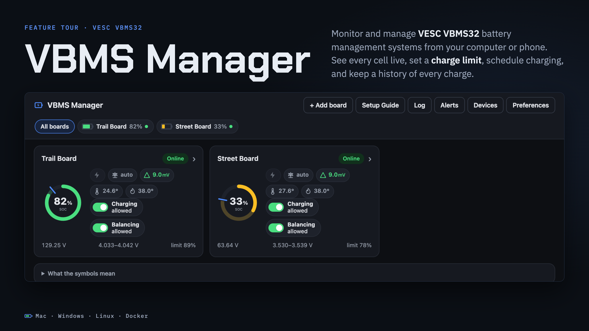

## 01 · The whole board at a glance

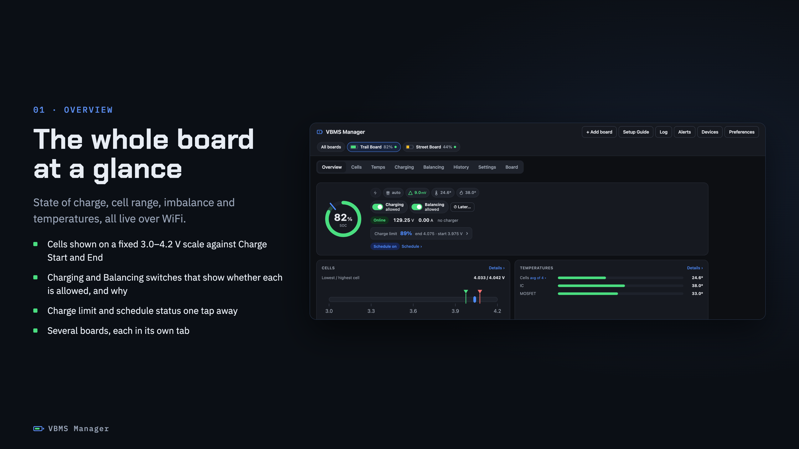

## 02 · Set a charge limit in percent

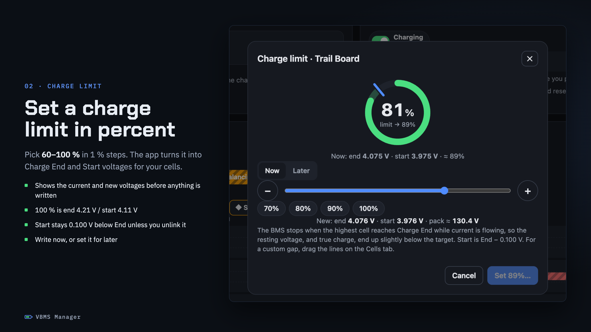

## 03 · Every cell, on one graph

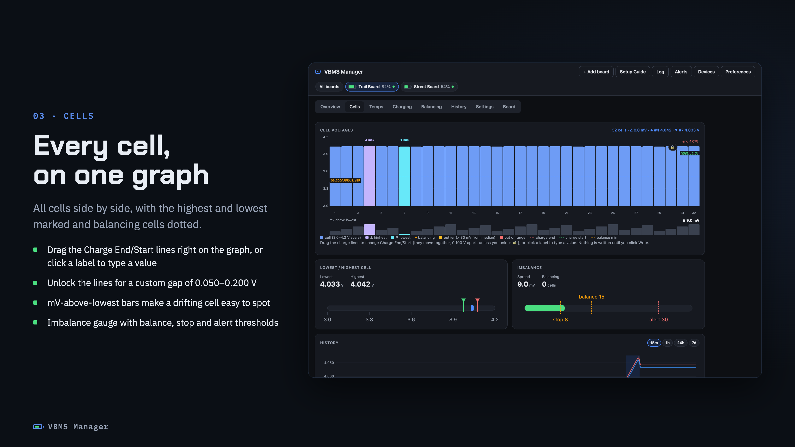

## 04 · Measured curves for real cells

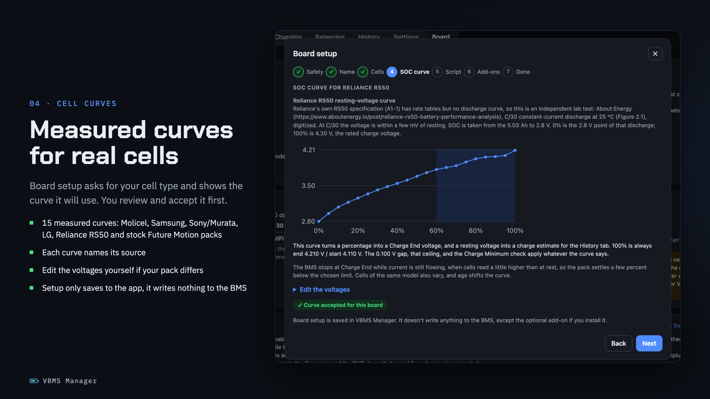

## 05 · Schedule charging and balancing

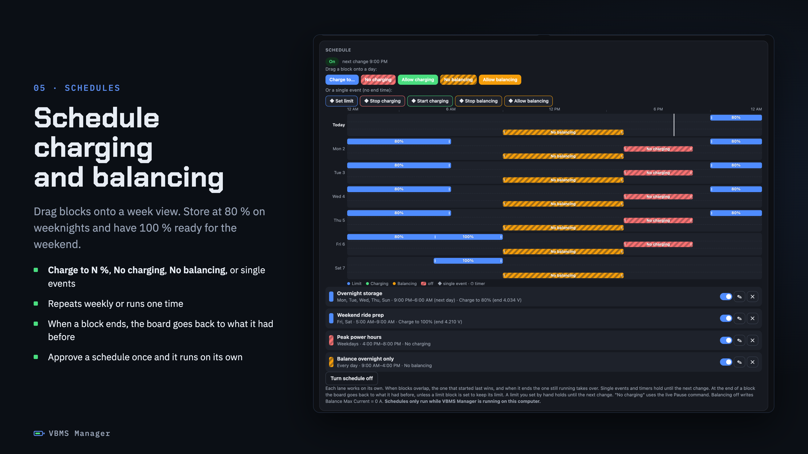

## 06 · One-off timers

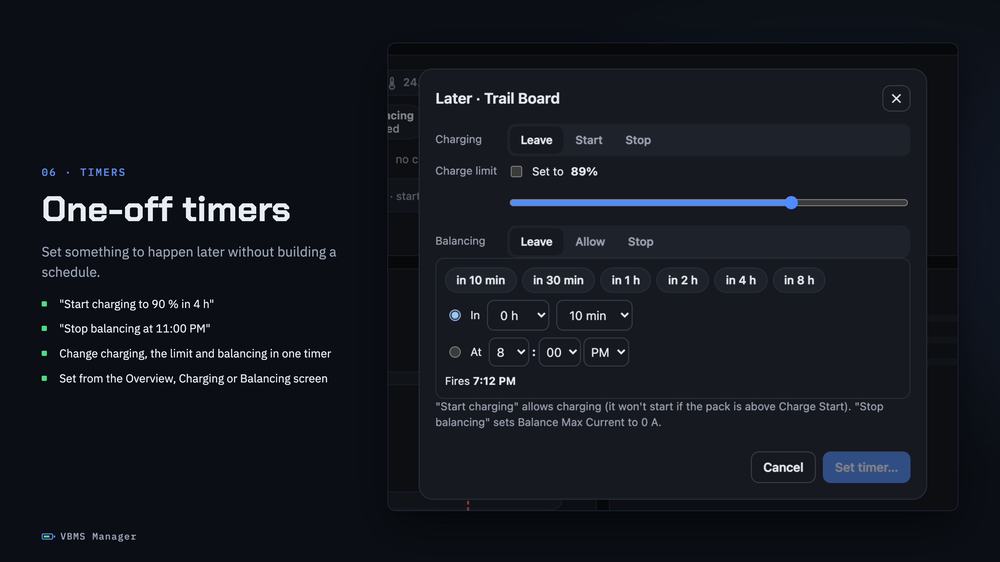

## 07 · See why it is or isn't balancing

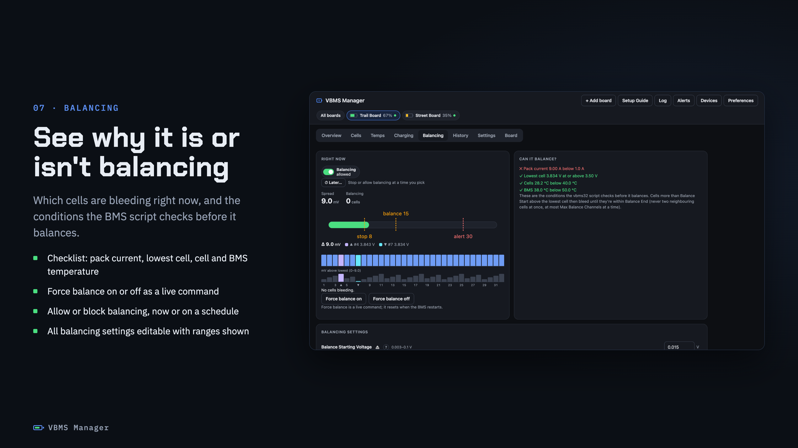

## 08 · Recorded history

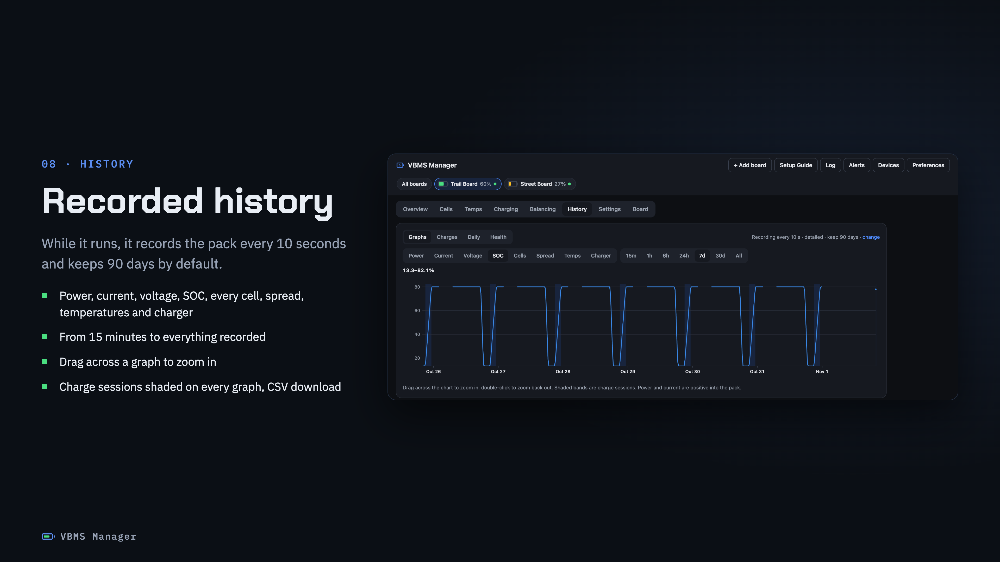

## 09 · Every charge, logged

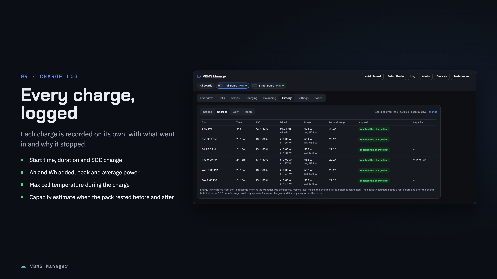

## 10 · Spot a weak cell early

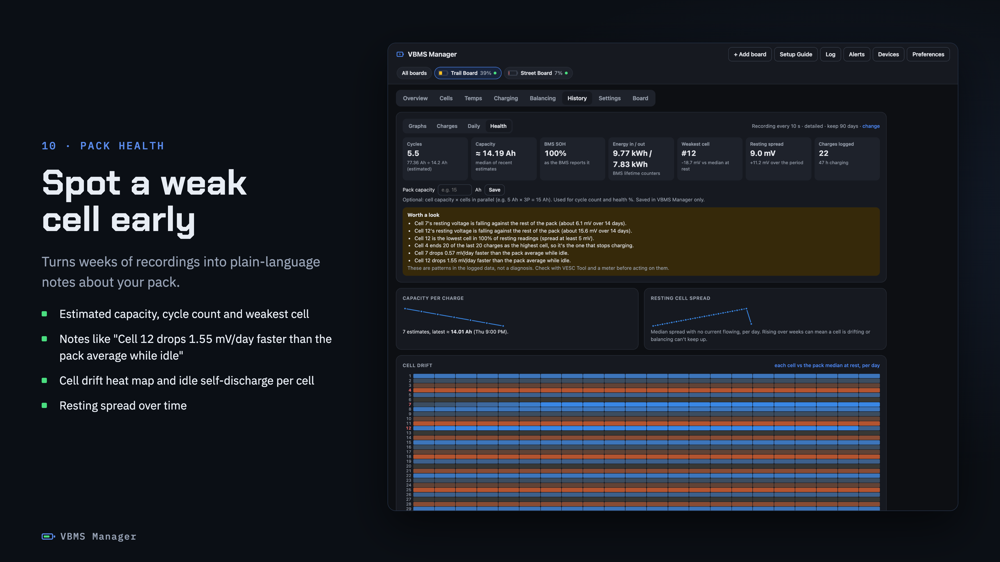

## 11 · Every BMS setting, with warnings

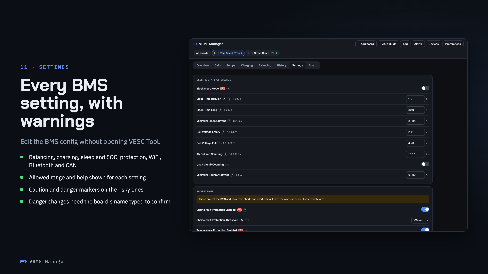

## 12 · From your phone, and more

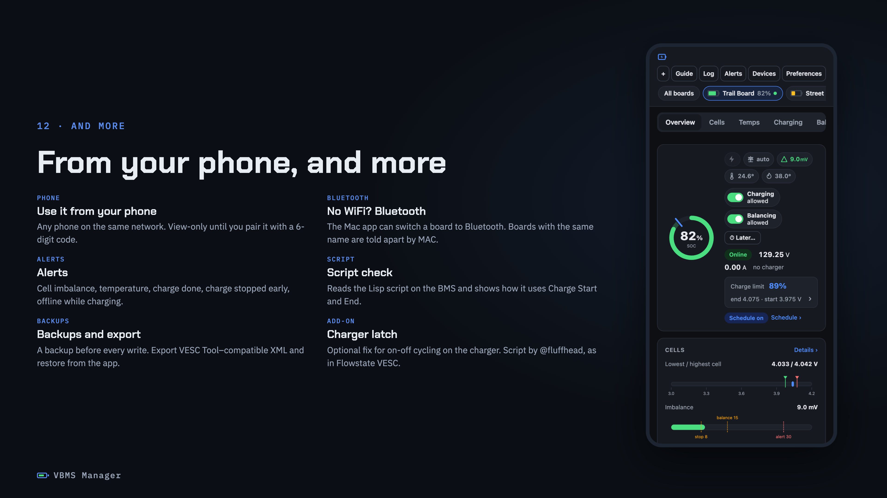

## 13 · Built for lithium packs

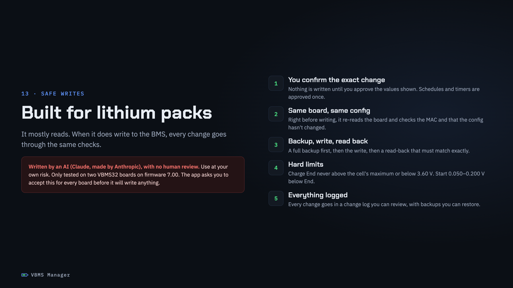
